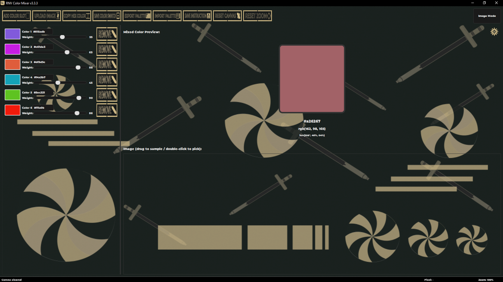
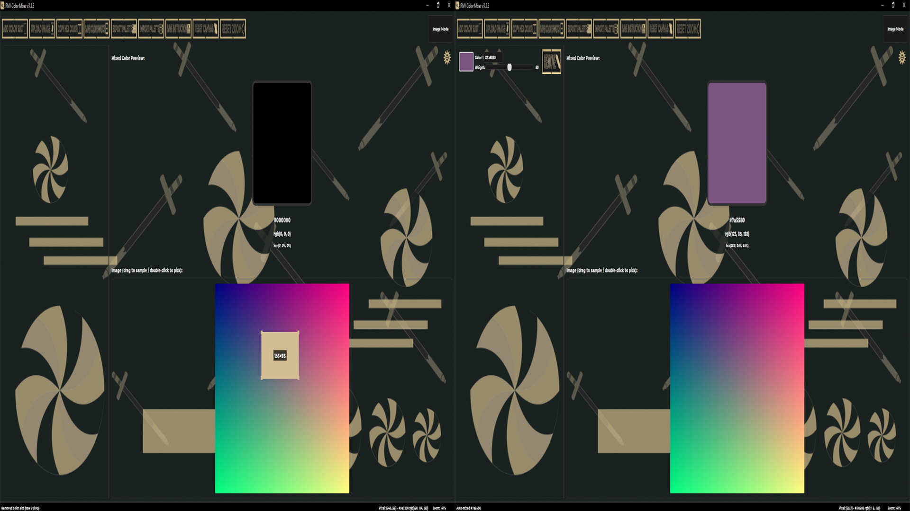
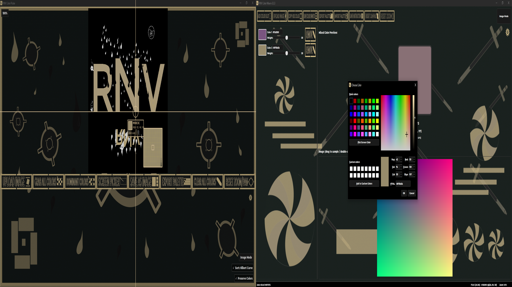
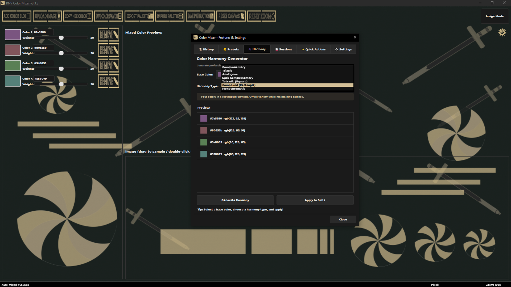
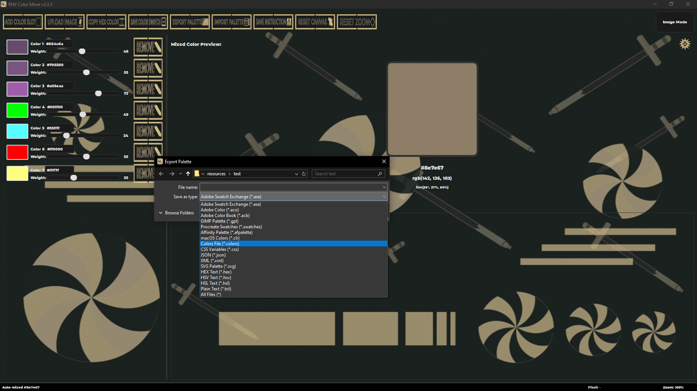
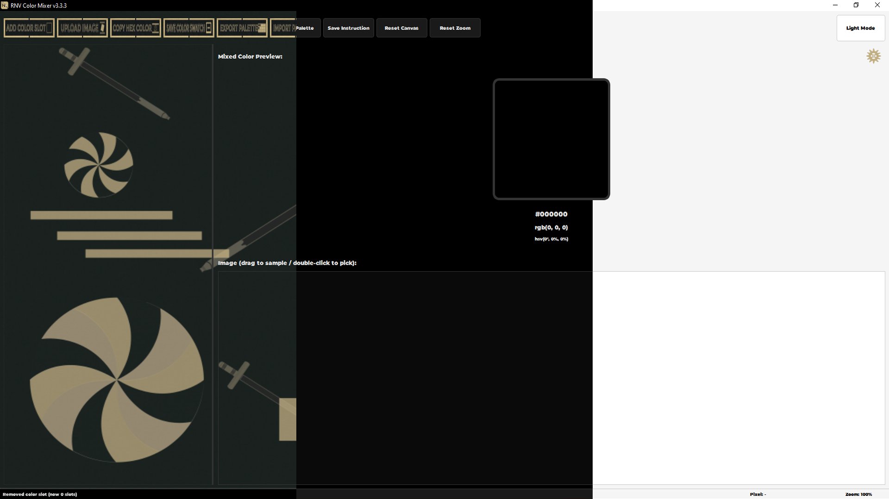

# RNV Color Mixer

> Bringing real-world paint mixing to the digital palette.


[](https://github.com/RNVizion/rnv-color-mixer/actions/workflows/tests-linux.yml)
[](https://github.com/RNVizion/rnv-color-mixer/actions/workflows/tests-windows.yml)

A desktop color-mixing application for artists, designers, and color
enthusiasts. Mix colors by weight with one of six algorithms (including
Kubelka-Munk paint theory), sample them from images and from anywhere on
screen, build color harmonies, and export palettes in 16 formats.

Built with Python 3.13+ and PyQt6.

---

## Screenshots

<table>
  <tr>
    <td width="50%" align="center">
      
      <br/><sub><b>Main window</b> — multi-slot color mixing with real-time preview</sub>
    </td>
    <td width="50%" align="center">
      
      <br/><sub><b>Image sampling</b> — double-click to sample a pixel, drag to average a region</sub>
    </td>
  </tr>
  <tr>
    <td width="50%" align="center">
      
      <br/><sub><b>Screen picker</b> — magnified crosshair sampling across all monitors</sub>
    </td>
    <td width="50%" align="center">
      
      <br/><sub><b>Color harmonies</b> — complementary, triadic, tetradic, and more</sub>
    </td>
  </tr>
  <tr>
    <td width="50%" align="center">
      
      <br/><sub><b>Palette export</b> — 16 formats including ASE, ACO, GPL, CSS, and JSON</sub>
    </td>
    <td width="50%" align="center">
      
      <br/><sub><b>Theme modes</b> — Dark, Light, and Image mode</sub>
    </td>
  </tr>
</table>

---

## Features

**Color mixing**
- Weighted mixing of up to 12 color slots (the default; the limit is a
  setting), each with its own weight slider
- Six algorithms: RGB (the default), HSV, LAB, CMY (subtractive: mixes
  like inks, each color filtering the light, so yellow and blue make a
  dark green), RYB (weighted), and Kubelka-Munk, chosen in Settings. Saving another one
  mixes the slots again at once
- Real-time preview with hex and RGB readouts, and HSV when turned on in
  Settings
- Right-click a slot for its menu: undo and redo, the fine-tune dialog
  (lighten/darken, saturate, hue shift, temperature, tint/shade), quick
  adjustments (lighten, darken, saturate, desaturate, warmer, cooler),
  pick a new color, copy the hex code, and reset

**Image sampling**
- Load an image with Upload Image (`Ctrl+O`) or by dropping it on the window.
  An image over 10 MB asks before it loads
- Double-click to sample a pixel; drag to average a region. Each sample goes
  into an empty slot, or a new one
- Hovering shows the pixel's position, hex and RGB
- Scroll-wheel zoom at the cursor; the scroll bars move around an image
  larger than the view, and Reset Zoom fits it again
- Cross-monitor screen color picker with a magnified crosshair overlay:
  click to pick, `Esc` to cancel

**Color harmonies**
- Seven types: complementary, analogous, triadic, split-complementary,
  tetradic (square), compound (rectangle), and monochromatic
- Apply to Slots fills the first slots with the harmony's colors, adding
  slots as needed

**Palette I/O**
- Export (16 formats): ASE, ACO, ACB, GPL, Procreate `.swatches`, Affinity
  `.afpalette`, macOS `.clr`, `.colors`, CSS, JSON, XML, SVG, HEX, HSV, HSL,
  and plain text
- Import (15 formats): the same except ACB. The format is chosen by the
  file's extension
- Save Instruction writes the slots' colors as a PNG of swatches; Save
  Color Swatch (`Ctrl+S`) writes the mixed color as a PNG or JPEG
- The Default Export Format setting picks the type a save dialog opens on:
  PNG or JPEG for Save Color Swatch, JSON, ASE or GPL for Export Palette.
  Any other type can still be chosen in the dialog
- Preset palettes: 15 built-in in six categories, plus your own (save and
  delete them in the Presets tab)

**Session management**
- Auto-save every 60 seconds. At startup, if the app did not close normally
  last time, it offers to restore that run's latest auto-save
- Save and load sessions by hand in the Sessions tab, which lists the 10
  most recent; the 6 newest auto-saves are kept
- With Auto-load last session on, the app opens the session at the top of
  Recent Sessions, the one last saved or loaded there. After a run that did
  not close, the recovery offer comes instead
- Color history of the mixed colors, 50 by default (the History Size Limit,
  1 to 1000): click one to load it into an empty slot, or export the history
  as JSON, HTML, or text. With Enable color history off, mixes are not added.
  Only your mixes are added: not the mix the app makes as it starts, nor a
  session's restored at startup, which the history holds from when it was made

**Theming**
- Three themes: Dark mode, Light mode, and Image mode (image buttons over a
  background picture). The theme button cycles them and remembers the
  choice for the next launch
- Auto (follow system), a Default Theme in Settings, opens in Light or Dark
  as the operating system is set and follows it when it changes. It never
  picks Image mode, and a press of the theme button ends it
- Custom tooltip system with full CSS control (bypasses native OS tooltip rendering)
- Embedded Montserrat Black font for consistent typography

### The window

The toolbar holds Add Color Slot, Upload Image, Copy Hex Color, Save Color
Swatch, Export Palette, Import Palette, Save Instruction, Reset Canvas
(clears the image), Reset Zoom, and the theme button. The gear at the top
right opens the Settings & Features panel.

### Settings & Features panel

Opened with the gear, `Ctrl+,` or `Ctrl+P`. Its six tabs:

- **History**: the recent mixed colors; clear, export, or refresh the list.
- **Presets**: built-in and saved palettes, filtered by category; load,
  save the current slots as a preset, or delete one of your own.
- **Harmony**: pick a base color from the slots and a harmony type, preview
  it, and apply it to the slots.
- **Sessions**: save the current session, and load, delete, or refresh the
  recent ones.
- **Quick Actions**: the keyboard shortcuts, export of the current mix as a
  swatch, quick palettes (complementary, analogous, triadic,
  split-complementary) from the mixed color, and the screen color picker.
- **Settings**: the default theme (Dark, Light, Image, or Auto, which
  follows the system), whether mixed colors are added to the history and
  how many it keeps, auto-loading the last session, default slot weight,
  maximum number of slots, tooltips, the default export format, debug
  overlays, animations, the mixing algorithm, and the RGB and HSV
  readouts. Its buttons load, save, export, import, and reset the
  settings. A choice takes effect when you press Save; the default theme
  is the one the app opens in.

---

## Tech Stack

| Layer | Technology |
|---|---|
| Language | Python 3.13+ |
| GUI | PyQt6 6.5+ |
| Image processing | Pillow |
| Testing | pytest, pytest-qt, pytest-timeout, hypothesis, unittest; rnv-brand at a pinned commit |
| Coverage | coverage.py (with branch coverage) |
| Build | PyInstaller (Windows + Linux) |

---

## Installation

Requirements: **Python 3.13 or newer**.

```bash
# Clone or download the project, then from the project root:
pip install -r requirements.txt
python RNV_Color_Mixer.py
```

If you want an isolated environment (recommended):

```bash
python -m venv venv
# Windows:  venv\Scripts\activate
# macOS/Linux:  source venv/bin/activate
pip install -r requirements.txt
python RNV_Color_Mixer.py
```

To work on the code and run the tests, see
[Setting up for development](#setting-up-for-development).

### Alternative: install as a package

The project ships with a `pyproject.toml`, so you can install it like any
other Python package. After installation, the app is available as a
`rnv-color-mixer` command on your PATH:

```bash
pip install .
rnv-color-mixer
```

Use `pip install -e .` instead for an editable install that picks up
code changes without reinstalling.

### Building a standalone executable

The project ships with a PyInstaller spec file and convenience wrapper
scripts for both Windows and Linux:

```bash
pip install pyinstaller

# Windows:
build_windows.bat

# Linux:
./build_linux.sh

# Or invoke PyInstaller directly (any platform):
pyinstaller RNV_Color_Mixer.spec
```

The build output lands in `dist/RNV_Color_Mixer/`. On Windows, zip the
folder and share it — end users can run `RNV_Color_Mixer.exe` without
installing Python or any dependencies. On Linux, tar the folder
(`tar -czf RNV_Color_Mixer-linux.tar.gz -C dist RNV_Color_Mixer`) and
distribute that.

The build uses **one-folder mode** rather than one-file mode. One-file
builds unpack to a temp directory on every launch, adding ~3 seconds
to startup; one-folder is larger on disk but launches instantly.

Note: Linux binaries built with PyInstaller are tied to the glibc
version of the build host. For maximum compatibility, build on the
oldest distro you want to support (e.g. Ubuntu 22.04 LTS).

---

## Keyboard shortcuts

| Shortcut | Action |
|---|---|
| `Ctrl+N` | Add color slot |
| `Ctrl+O` | Upload image |
| `Ctrl+C` | Copy mixed color as hex |
| `Ctrl+S` | Save mixed color as image swatch |
| `Ctrl+Shift+C` | Launch screen color picker |
| `Esc` | Cancel the screen color picker |
| `Ctrl+,` or `Ctrl+P` | Open settings & features panel |
| `Ctrl+/` | About dialog |
| `F11` | Toggle tooltips |
| `F12` | Toggle debug overlays |

**Mouse**

| Gesture | Action |
|---|---|
| Double-click the image | Sample one pixel into a slot |
| Drag across the image | Average the region into a slot |
| Scroll wheel over the image | Zoom in or out at the cursor |
| Click while the screen picker is open | Pick the color under the cursor |
| Right-click a slot | Open the slot's menu |
| Click a slot's swatch | Choose its color in a color dialog |

---

## Project structure

```
rnv-color-mixer/
├── RNV_Color_Mixer.py       Main application entry point
├── test_rnv_color_mixer.py  Comprehensive test suite (Suite 1, locked)
├── run_tests.py             Unified test runner (both suites + coverage)
├── pytest.ini               Pytest configuration
├── .coveragerc              Coverage.py configuration
├── pyproject.toml           Project metadata & packaging config
├── requirements.txt         Runtime dependencies
├── in.sh                    Development setup (Linux / Codespaces)
├── in.ps1                   Development setup (Windows)
├── brand_map.json           Where each color comes from: rnv-brand or the app
├── COLORS.md                This app's color chart, written by the sync
├── ACCENT_IMAGES.md         The images that carry the gold, written by tools/accent_images.py
├── RNV_Color_Mixer.spec     PyInstaller build specification
├── RNV_Color_Mixer.pyproj   Visual Studio project file
├── build_windows.bat        Windows build convenience script
├── build_linux.sh           Linux build convenience script
├── clean_python_cache.bat   Cache cleaner (Windows)
├── clean_python_cache.sh    Cache cleaner (macOS / Linux)
├── README.md                This file
├── CHANGELOG.md             Release history
├── KNOWN_ISSUES.md          Known issues, and the record of past fixes
├── LICENSE                  MIT license
├── .gitattributes           Line-ending rules (snapshots are binary)
├── .gitignore
├── .github/workflows/       GitHub Actions CI (Linux + Windows), and the daily brand sync
├── core/                    Color science, palettes, data models
│   ├── color_math.py            Mixing and color-space conversions
│   ├── color_slot.py            One color slot: swatch, hex entry, weight slider, menu
│   ├── color_fine_tune.py       The slot's fine-tune dialog
│   ├── color_harmony.py         Harmony generator
│   ├── color_history.py         Recent mixed colors
│   ├── preset_palettes.py       Built-in and saved presets
│   ├── palette_formats.py       Palette import and export
│   ├── image_handler.py         Image loading, zoom and sampling
│   ├── screen_color_picker.py   Cross-monitor screen picker
│   ├── package_d_panel.py       The Settings & Features panel
│   └── py.typed
├── ui/                      Visual layer
│   ├── canvas_view.py           Image canvas: hover, sampling, zoom
│   ├── ui_handler.py            Theme application
│   ├── about_dialog.py          About dialog (Ctrl+/)
│   ├── debug_button.py          Image-mode button
│   ├── debug_overlay.py         Dimension overlays (F12)
│   └── py.typed
├── utils/                   Cross-cutting services
│   ├── colors.py                Every color the app draws (values written by the sync)
│   ├── config.py                Constants, paths, ThemeManager
│   ├── atomic_write.py          Atomic writes for the files the app keeps
│   ├── async_file_ops.py        Background file writer thread
│   ├── settings_manager.py      Settings file
│   ├── session_manager.py       Sessions and auto-save
│   ├── signal_manager.py        Signal connection tracking
│   ├── pixmap_cache.py          LRU pixmap cache
│   ├── file_utils.py            File dialogs and palette import
│   ├── clipboard.py             Clipboard
│   ├── dialog_helper.py         Message dialogs
│   ├── error_handler.py         Error handling helpers
│   ├── logger.py                Logging
│   ├── pil_compat.py            Pillow compatibility
│   └── py.typed
├── tools/
│   ├── sync_colors.py           Writes the colors in utils/colors.py, and COLORS.md
│   └── accent_images.py         Writes ACCENT_IMAGES.md
├── tests/                   Suite 2: test_*.py (pytest), conftest.py,
│                            color_values.py, requirements-dev.txt
├── snapshots/               Reference data for byte-locked tests
├── resources/               Fonts, icons, button images, background, screenshots, test images
└── docs/                    Developer documentation
```

For notes on the signal connection manager and the pixmap cache, see
[`docs/INTERNALS.md`](docs/INTERNALS.md).

---

## Setting up for development

Two scripts at the repository root set up a checkout. Both install the same two files:
`requirements.txt`, which is what the app needs to run, and `tests/requirements-dev.txt`,
which adds the test tools and rnv-brand at the commit this repository pins.

```powershell
# Windows (PowerShell 7)
.\in.ps1                      # makes .venv with Python 3.13 if there is none, then installs
.\.venv\Scripts\Activate.ps1
```

```bash
# Linux or Codespaces
./in.sh                       # also installs the Qt system libraries with apt-get
```

rnv-brand is installed from GitHub at a pinned commit, so the second file needs `git` and
network access. Run the script again after any change that moves the pin; the
register-pin test fails while the installed brand is not the pinned one.

---

## Testing

The project carries over 1,100 tests across two harnesses:

| Harness | Tests | Notes |
|---|---|---|
| `unittest` | over 300 | Locked byte-integrity suite (`test_rnv_color_mixer.py`) |
| `pytest` | over 800 | Modern suite — pytest-qt for Qt threading, hypothesis property tests |
| **Total** | **over 1,100** | Branch coverage enabled |

**Run the full suite:**

```bash
# One-time setup: see "Setting up for development" above

# Run all tests with coverage
python run_tests.py

# Other modes
python run_tests.py --report     # regenerate report from existing data
python run_tests.py --summary    # gaps view (skip 100%-covered files)
```

This runs both harnesses sequentially and produces a combined coverage report.

Coverage is measured on every full run. `python run_tests.py --report` prints the current
figure for every module; it differs a little between Windows and Linux. CI fails a run
whose total falls below the floor set in the workflow (`--fail-under`).

Both CI runners run both suites complete: no test is skipped or deselected
for the platform. [`KNOWN_ISSUES.md`](KNOWN_ISSUES.md) keeps the record of
the tests that once were, and why each came back. A few checks skip on
every run by design, each with its reason: the guards shared by the five
RNV apps skip the parts that belong to another app, and
`tests/test_hint_text.py` skips the pairs it records as accepted.
`python -m pytest tests/ -rs` lists them.

The locked test file (`test_rnv_color_mixer.py`) has its SHA-256 verified
on every CI run, preventing accidental modification.

### Guard tests

Besides the tests of the app's behavior, a set of guard tests holds rules that span the
repository:

| Test | Holds |
|---|---|
| `tests/test_colors_in_sync.py` | the color file and `COLORS.md` are what `brand_map.json` and the pinned brand say |
| `tests/test_register_pin.py` | the installed rnv-brand is the pinned commit |
| `tests/test_atomic_state_writes.py` | every file the app keeps is written atomically |
| `tests/test_status_carried_by_a_word.py` | a status is never shown by color alone: each one has a word or a mark beside it |
| `tests/test_accent_images.py` | `ACCENT_IMAGES.md` matches the images |
| `tests/test_setup_scripts.py` | `in.sh` and `in.ps1` install the same files |
| `tests/test_readme_test_counts.py` | every test count the docs state is a floor that holds |

---

## Architecture Highlights

**Centralized colors (`utils/colors.py`)** — every color the app draws is
named in one file. Theme dicts (`DARK_THEME`, `LIGHT_THEME`, `IMAGE_THEME`,
served by `ThemeManager` in `utils/config.py`) are referenced by key
throughout the codebase. Any hardcoded color elsewhere is a bug. The values
themselves are written by a sync; see [Changing a color](#changing-a-color).

**Signal lifecycle management (`utils/signal_manager.py`)** — the main
window, the image canvas, the color slots, the screen picker and the debug
overlays track their own signal connections through
`SignalConnectionManager` or `SignalMixin`, so each can disconnect them in
one call; the main window disconnects all of its tracked connections when
it closes. Other connections are made directly.

**Zoom cache (`core/image_handler.py`)** — the canvas keeps the QImage it
built for the current zoom level, so a repaint at the same zoom does not
convert the image again. A new image or a new zoom level clears it.

**Background history saves (`utils/async_file_ops.py`)** — the color
history is written on a `QThread` worker, so adding a color never waits on
the disk. Sessions, settings and palette exports are written directly.

**Custom tooltip system** — implemented as a `_ThemedToolTip` widget with
`WA_TranslucentBackground`, because native Qt tooltips on Windows ignore
CSS border-radius. Restored via stable widget-name keys (not `id(widget)`
memory addresses, which change between storage and retrieval).

**Type-annotated codebase** — PEP 604 modern syntax (`X | None` over
legacy `Optional[X]`). Ships with `py.typed` markers (PEP 561) in `core/`,
`ui/` and `utils/`, and a `[tool.mypy]` config block for static type
checking.

For deeper implementation details, see [`docs/INTERNALS.md`](docs/INTERNALS.md).

---

## Changing a color

The app's colors live in `utils/colors.py`, but their values are not edited there.
`brand_map.json`, at the repository root, says where each one comes from: a name in
rnv-brand (such as `APP.accent`) or a value this app owns, with the reason.
`tools/sync_colors.py` writes the value on each of those lines, and writes `COLORS.md`, the
chart of this app's colors.

- **A color this app owns:** change its value in `brand_map.json`, then run
  `python tools/sync_colors.py`.
- **A brand color:** it changes in rnv-brand first. Move the pin in
  `tests/requirements-dev.txt`, reinstall (above), then run `python tools/sync_colors.py`.
  The diff of `utils/colors.py` shows exactly what moved. The `brand-sync` workflow does
  this every day and opens a pull request only when a color this app uses has moved.
- `python tools/sync_colors.py --check` writes nothing and exits 1 if the color file or
  `COLORS.md` is out of date. `tests/test_colors_in_sync.py` runs it on every test run, so
  a value edited by hand in `utils/colors.py` fails the suite until the map says the same.

A derived color, such as a lightened or translucent step of the gold, stays code in
`utils/colors.py` and follows its base.

**The images do not follow.** Button art, backgrounds and icons have the gold drawn into
their pixels. `ACCENT_IMAGES.md` lists every image that carries it; `tools/accent_images.py`
writes that list (`--check` writes nothing) and never changes an image.
`tests/test_accent_images.py` keeps the list current.

---

## Files the app keeps

Settings, sessions, history, presets and recent files are written atomically through
`utils/atomic_write.py`: the new content goes to a temporary file beside the real one, is
flushed to disk, and replaces the original in one step. A crash or a full disk during a
save leaves the old file or the new one, never half of each. Exports you ask for, such as
a palette file or an image, are not state and keep their own writers.
`tests/test_atomic_state_writes.py` lists every writer and fails if one writes in place.

Where they are:

| File | Location |
|---|---|
| Settings | `settings.json` in `%APPDATA%\ColorMixer` (Windows), `~/Library/Application Support/ColorMixer` (macOS), or `~/.config/ColorMixer` (Linux) |
| Sessions and auto-saves | `~/.color_mixer/sessions/` (`*.session`; auto-saves start with `.autosave_`) |
| Recent sessions list | `~/.color_mixer/sessions/.recent_sessions.json` |
| Crash-recovery flag | `~/.color_mixer/sessions/.recovery_needed`, present while auto-save is running |
| Color history | `~/.color_mixer_history.json` |
| Your presets | `~/.color_mixer_presets.json` |

---

## Related Projects

Part of the RNVizion suite of color tools:

- **[RNV Color Picker](https://github.com/RNVizion/rnv-color-picker)** — Professional color extraction and palette management for designers and developers
- **[RNV Color Palette Manager](https://github.com/RNVizion/rnv-color-palette-manager)** — A professional desktop application for creating, managing, and exporting color palettes

---

## Development notes

**Clean Python cache files:**

```bash
# Windows
clean_python_cache.bat

# macOS / Linux
./clean_python_cache.sh
```

Stale `__pycache__` directories can cause confusing import errors after
updating files — run the appropriate script for your OS if you see
unexpected behavior.

---

## License

[MIT](LICENSE) — free to use, modify, and distribute.

---

## Author

Built by [RNVizion](https://github.com/RNVizion)

---

<p align="center">
  Built with PyQt6 · over 1,100 tests · Cross-platform CI
</p>
